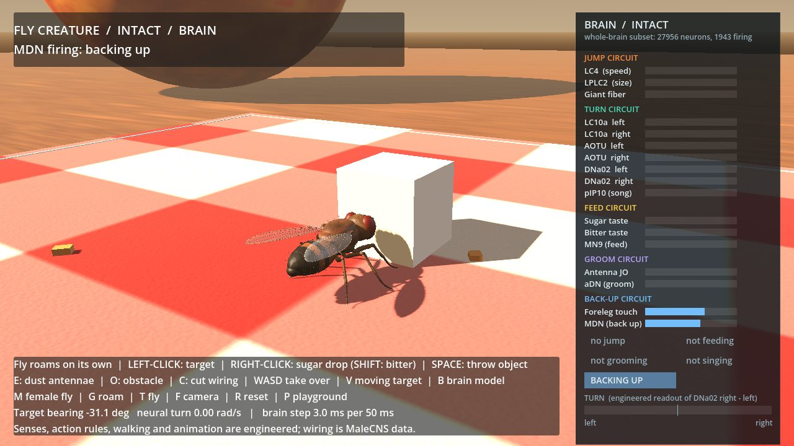

# melanogaster

**A fruit fly's real wiring diagram, put to work.** A playable 3D fruit fly whose
reactions run on the recorded wiring of a real fly's brain and nerve cord: the
FlyEM Male CNS connectome, 211,577 neurons.

**[Live demo](https://silascroe.github.io/melanogaster/):** 4,871 neurons of that
wiring running in your browser. Touch the cartoon fly's feet and watch its
backing-up neurons decide, then cut the wiring and watch them go dark.



## What the fly does

The creature lives in [`fly-creature/`](fly-creature/). Each reaction feeds a
sense into the neurons that receive it in the real fly, runs a reimplementation
of the published whole-brain spiking model (Shiu et al., *Nature* 2024), and
reads the neurons that command the action. Every reaction was first tested on
the whole brain, with the pass rule written down before the run, against brains
whose wiring was randomly shuffled.

| Reaction | Sense goes into | Action is read from | Whole-brain test |
|---|---|---|---|
| Jump away from a looming object | LC4, LPLC2 | giant fibre (DNp01) | ~404 Hz; at most 34.5 Hz in 20 shuffled brains |
| Steer toward a target | LC10a, one side | DNa02, left minus right | 104–168 Hz toward the target's side in every trial; beats all 20 shuffles |
| Feed on sugar | labellar taste LB3 | MN9 (proboscis) | 66–78 Hz; 0 Hz in all 20 shuffles |
| Refuse bitter sugar | LB3 plus bitter LB1 | MN9 | 99% suppressed; at most 33% with bitter wiring scrambled |
| Groom dusty antennae | Johnston's organ C/E | aDN | ~200 Hz; at most 3.25 Hz in shuffles |
| Court with song | LC10a, one side | pIP10 | 38–47 Hz; beats all 20 shuffles, by a narrower margin |
| Back up from an obstacle | foreleg touch bristles | MDN | 16–17 Hz; 0 Hz from hind legs; beats all 20 shuffles |

The full record, including the tests that failed, is in
[the whole-brain result](fly-creature/docs/whole_brain_result.md).

## What is real and what is ours

- **Real:** which neuron connects to which, with how many synapses, and whether
  each neuron is predicted to excite or inhibit. That comes from the Male CNS
  release.
- **Simplified:** every neuron is the same leaky integrate-and-fire unit with
  the published model's settings. Its firing rates are not claims about a real fly.
- **Engineered:** how each sense becomes input, the firing thresholds that
  trigger actions, the walking, the animation, and timers such as how long the
  fly backs up.
- **The biggest limit:** each sense runs its own copy of a brain subset, and a
  copy resets to rest after half a second without input. The published model,
  run as one continuous brain, never settles down after a stimulus: thousands of
  neurons keep firing and the senses leak into each other's actions. Two fixes
  were tried with their pass rules declared first, and both failed. So this is
  several brief brains taking turns, not one integrated, remembering fly.

## Play it

On Windows with Python 3.12 and Godot 4.7, double-click
`fly-creature/Play-Fly-Creature.cmd`. Setup, controls and the honesty notes for
each reaction are in [the creature README](fly-creature/README.md). The game
ships its own compact brain subsets; the 1 GB connectome release is only needed
to rebuild them.

## What is in this repository

- [`fly-creature/`](fly-creature/) is the creature: Python brain service, Godot
  game, packaged brain subsets, tests and records. It runs without anything else
  in this repository.
- [`fly-creature/site/`](fly-creature/site/) is the live demo page, published by
  [`.github/workflows/pages.yml`](.github/workflows/pages.yml) after its checks pass.
- [`lab/`](lab/) is the original FlyTest lab and its Godot arena, kept as a
  record. Its small hand-picked circuits could not carry signals through relay
  neurons, which is why the creature moved to the whole brain. See
  [its README](lab/README.md).
- `data/` holds the connectome release locally (not in Git); see below.
- [`docs/`](docs/) has the [current handoff](docs/HANDOFF.md), the
  [data dictionary](docs/data-dictionary.md) and the
  [Git workflow](docs/git-workflow.md).

## The data

The project uses [FlyEM Male CNS v1.0](https://male-cns.janelia.org/download/).
The release files are not in Git. The untouched download lives in
`data/original-data/male-cns-v1.0/` and is never edited; a byte-identical
working copy lives in `data/working/male-cns-v1.0/`.
[data/metadata/source_manifest.json](data/metadata/source_manifest.json) records
the source URLs, sizes and hashes. Check both copies with:

```powershell
.\.venv\Scripts\python.exe -m pip install -e "lab[dev]"
.\.venv\Scripts\python.exe -m flytest.verify
```

## Credits

Wiring: the Male CNS connectome is a collaboration between FlyEM at HHMI
Janelia, the University of Cambridge Department of Zoology, the MRC Laboratory
of Molecular Biology and Google Research, and is licensed CC-BY. Neuron model:
settings from Shiu et al. (2024), *A Drosophila computational brain model
reveals sensorimotor processing*, [code](https://github.com/philshiu/Drosophila_brain_model);
reimplemented here, not the authors' code. Neuron identities and the choice of
input groups draw on the papers cited in the creature's records.

This is a toy built on real data, not a validated model of fly behaviour.
