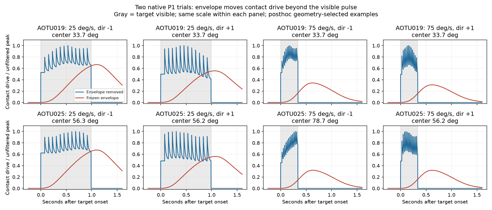

# Bounded diagnosis: retire the transferred-envelope candidate

Codex, 2026-10-09. This is a posthoc diagnosis of the
[failed recorded benchmark](lc10a_recorded_benchmark_result.md), not a new
qualification experiment. The frozen response, runner, protocol, folds,
contacts and playable controller are unchanged.

## Finding in plain language

Our added response memory moves much of the signal until after the short
target has disappeared. Removing that memory recovers most of the loss, but
does not establish useful superiority over the old predictor or simple weights.
The temporal equation was translated correctly. The unsupported step was
transferring its shape into this different image-to-activity/AOTU model.

**Decision: retire this primary rule as a candidate for promotion.** Keep the
renderer, source audit, anatomical hypotheses and reproducible diagnostics.
Do not keep tuning this rule against the same archive, or silently substitute
the best ablation for the frozen primary. This does not reject LC10a biology,
the connectome, or all possible pursuit models.

## Reproduction and competing explanations

The saved P1 recording scores reproduce the primary failure: error ratios
versus legacy are 1.171251 for AOTU019 and 1.098918 for AOTU025. We tested the
following bounded explanations using already-scored one-factor ablations and
two native recording replays, without a new full benchmark or parameter search.

| Explanation | Prediction | Result |
| --- | --- | --- |
| Borrowed envelope delays/suppresses short-pulse response | Removing only the envelope recovers fit; native drive peaks late | Supported as the main recoverable loss under this construction |
| Synthetic spatial/motion rule dominates failure | Removing surround/direction, or changing width, substantially recovers fit | These existing ablations do not recover comparable fit; this does not validate their assumptions |
| Nearest lookup erases the relevant signal | Interpolation restores large responses in selected pulses | Only 0.04–1.50% change in primary pulse means; not the dominant loss in these examples |
| Specific anatomy supplies useful advantage | With the problematic envelope removed, intact beats matched spatial consistently | Not supported across both types; AOTU019 favors matched spatial |

The old symmetric 50 ms observation filter remains fixed. No measured rate was
filtered again. Interpolation is a local representation probe, not a scored
replacement predictor; no new calibration was fitted.

## Already-scored ablation evidence

P1 mean recording RMSE, spikes/s; lower is better. Each predictor uses its
original fixed fitting budget and held-recording folds.

| Type | Legacy intact | Frozen primary intact | Envelope removed, intact | Envelope removed, matched spatial |
| --- | ---: | ---: | ---: | ---: |
| AOTU019 | 6.4514 | 7.5562 | 6.4700 | 6.3388 |
| AOTU025 | 9.2158 | 10.1274 | 9.1529 | 9.2782 |

Envelope removal gives AOTU019 13/24 wins against legacy, with aggregate error
0.29% worse. AOTU025 wins 13/22, with error 0.68% better. Neither clears the
frozen 5% improvement and 60% recording-win requirements. The instantaneous
intact matrix is 2.07% worse than matched spatial for AOTU019 and 1.35% better
for AOTU025. There is no joint wiring-advantage qualification.

## Native traces and implementation checks

Replay trial zero of the lexicographically first retained P1 recording of each
type: AOTU019/2023_05_08_fly01 and AOTU025/2024_05_31_fly02. This is 122,667
native samples before mirrors, at the original approximately 1.5 ms step.
All finite samples and intervening blank periods are retained; history resets
only at trial start. For display select one quiet pulse per speed/direction,
closest to the pre-existing 35/65-degree control centers, breaking ties by time.
Selection never uses measured rates. AOTU025 centers differ across panels, so
these are demonstrations within each pulse, not matched estimates of speed tuning.

The four fast pulses last 0.338–0.341 s; their primary contact-drive peaks occur
0.617–0.630 s after onset. Their mean raw drive during visibility is only
6.1–6.9% of the envelope-removed drive for the exact same movie and contacts.
For the four slow pulses the retained fraction is 40.8–43.7%. These are
uncalibrated contact-drive ratios, not fractions of biological firing.

The source-inspired kernel peaks at 411.4 ms and has a 587.8 ms mean lag; only
17.6% of its mass lies before 300 ms. An independent transcription of the pinned
MATLAB equation, substituting `times = -lag`, matches the Python kernel within
2.22e-16. Source files match the frozen source manifest. This rules out a sign
or coefficient transcription error, not inappropriate transfer between models.

Every quiet trial-zero cell for primary/instantaneous intact/matched-spatial
reproduces the saved raw predictions within 2.78e-17. Moving the linear envelope
after contact projection for this diagnostic is checked numerically against
enveloping the LC10a vectors first. Existing independent benchmark checks cover
full-image versus optimized feature parity. No arithmetic defect was found in
the tested seams, so there is no production bug fix or new regression claim.

## Why the source does not justify a quick replacement

The [author repository](https://github.com/rutalaboratory/LC10NetworkModel)
describes an integrate-and-fire population with estimated spatial fields and
a spike-difference turning readout. Its pinned `temporalRF_LC10.m` computes
**input current**; `sampleLC10Model_tethered.m` feeds that current into membrane
and spike-adaptation dynamics. We borrowed the envelope shape, then used it
as dimensionless activity, contact-weighted it and applied an AOTU lookup.
That is a declared transfer hypothesis, not a reproduction of the author model
or a measured LC10a-to-AOTU spike transfer. This diagnosis finds no defensible
new electrical time constant, per-cell field, or downstream dynamics to replace
it with. Faster constants chosen from these scores would be tuning.

Before another candidate, define a new bounded scientific question with an
observable input/output and evidence that constrains the missing transformation.
If we retain pursuit, first distinguish a source-model reproduction from a
MaleCNS wiring experiment; reproducing source behavior alone cannot establish
MaleCNS-specific advantage. Sol medium is recommended for that decision/design;
Luna Max for execution after the contract is concrete.

## Reproduce

From the workspace root with the existing ignored archives and benchmark:

    .\.venv\Scripts\python.exe fly-creature\tools\diagnose_lc10a_response.py

The run takes roughly 30 seconds locally and asserts source/archive hashes,
the original failure, projection/envelope commutation and native/cache parity.
[Compact evidence](evidence/lc10a_response_diagnosis_v1.json) records exact
scores, selection, pulse metrics and input hashes. The two full traces remain
in ignored `outputs/research/lc10a-response-diagnosis-v1/`. The script's first
execution reached passing replay checks but failed while serializing a NumPy
integer; explicit scalar handling corrected that report-writing defect.
