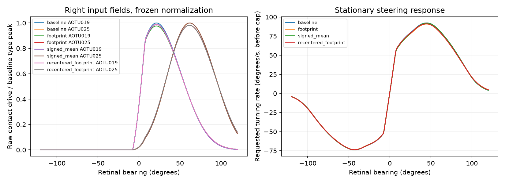

# Column-footprint candidate: implemented, no tracking improvement

2026-10-02. [Frozen protocol](pursuit_footprint_protocol.md),
[JSON](evidence/pursuit_footprint_v1.json), [CSV](evidence/pursuit_footprint_v1.csv).
Production Python/Godot settings and the previous packaged center map are unchanged.



## What was built

The portable [footprint data](../src/fly_creature/data/lc10a_column_footprints_v1.json)
retain 979 cell-column entries across 164 directly mapped LC10a neurons,
covering 517 distinct registered coordinates. Each entry contains the column
address, registered angle, aggregate upstream contact count and interpolation
method. The other 111 neurons retain their existing center fallback.
The derivation re-reads the official working release and pinned eye-map blobs,
reproducing the previous per-cell weighted means and spreads to their saved
precision. It does not use downstream weights, author response curves or
behavioral scores to assign angles.

The [offline adapter](../src/fly_creature/pursuit_footprints.py) computes each
direct cell's response as the contact-weighted mean of Gaussian responses at
its upstream column angles, rather than one Gaussian at its mean angle.
It averages over mapped upstream contacts, not all incoming contacts, and does
not invent positions for unannotated inputs. It retains the 15-degree aperture,
fixed type normalization, ELU, direction rule, recorded downstream weights,
gain, 200 ms delay and turn cap. No per-cell response-peak normalization is added.

The 18-degree kernel is now a **column-level hypothesis**, not a measured
response width. Incoming source types/signs and elevations are not simulated;
the selected positive contact weights describe an anatomical footprint only.
The same cross-specimen registration and fallback uncertainty remain.
No full optic-lobe network or new behavior has been built.

## Fixed-fly checks first

All candidate responses are finite and between zero and one. Fallback response
arrays are byte-for-byte numerically identical to baseline (maximum difference
zero). Direct plus fallback drives reconstruct the full response. Frozen type
peaks/output weights remain unchanged; no new raw-input clipping occurs in the
visible range. The mixture lowers most response peaks slightly, as expected
from averaging kernels; peaks are not rescaled to hide that change.

The candidate preserves the main spatial split: AOTU019 peaks at right 21 and
left 18 degrees, AOTU025 at 62 degrees on both sides. Mean peak separation stays
42.5 degrees and exceeds all 32 within-side shuffled controls, just as baseline
does. Anatomical spatial ordering survives this input change.

At stationary right 105 degrees, signal rises from **0.2210 to 0.2324**:
requested turn from **14.36 to 15.11 degrees/s**. The previous reference was
56.53 degrees/s. Keeping the spatial distribution therefore accounts for very
little of the previously observed wide-angle gap under this kernel assumption.

The signed-mean control changes only the handling of negative direct means
(using the old map's four-decimal precision). The recentered-footprint control
keeps the old clipped mean while adding spread. Neither exposes a large hidden
improvement. This does not prove all richer visual models are useless; it argues
against center collapse alone being the main cause in the present model.

## Behavior replays and wiring controls

All 22 previously consumed paths were replayed with unchanged body/timing.
The 32 baseline and candidate shuffles use identical permutations, matching the
previous benchmark seed. All baseline/shuffle metrics reproduce exactly.
Mean absolute retinal errors, degrees (lower is better):

| Family | Baseline | Footprint candidate | Signed mean only | Recentered footprint |
| --- | ---: | ---: | ---: | ---: |
| Stationary steps | 6.310 | 6.364 | 6.305 | 6.368 |
| Slow sweeps | 6.267 | 6.282 | 6.289 | 6.240 |
| Fast sweeps | 25.241 | 25.268 | 25.239 | 25.261 |
| Smooth paths | 7.875 | 7.935 | 7.942 | 7.901 |
| Older motion paths | 7.180 | 7.238 | 7.218 | 7.200 |

The primary candidate is slightly worse on all five aggregates. More detailed
anatomical input has not produced better behavior here.

| Family | Baseline intact beats shuffle aggregates | Footprint intact beats shuffle aggregates |
| --- | ---: | ---: |
| Steps | 32/32 | 32/32 |
| Slow sweeps | 26/32 | 19/32 |
| Fast sweeps | 32/32 | 32/32 |
| Smooth paths | 15/32 | 2/32 |
| Older motion paths | 23/32 | 13/32 |

Specific wiring still separates frontal/lateral fields, but its motion-dependent
behavioral advantage weakens. Shuffle ranks are descriptive, not independent
statistical trials or biological validation. No candidate is promoted and no
fresh held-out promotion set has been consumed. Translating-world regression
tests are not warranted as a promotion step for this unsuccessful candidate.

## An important coverage limit

At left 105 degrees, **90.1% of AOTU025 raw drive still comes from fallback
cells**, versus 22.0% on the right. Left AOTU019 is 71.2% fallback there.
Thus this candidate cannot validate the left-side wide-angle field: most of
that response remains the old estimate. This spatially specific coverage is
more informative than the overall directly mapped cell count. The direct/fallback
contributions are saved separately in the evidence.

## Verification and reproduction

Four new tests check packaged coverage/moments, explicit weighted-column sums,
fallback identity, zero-spread equivalence, frozen normalization and invalid
data rejection. All **112 lab/creature tests pass**. Two data derivations are
byte-identical; two complete reports and plots are byte-identical. The 1,496
replays include 726 baseline/shuffle comparisons that exactly reproduce prior
metrics. Twenty family means and ten wiring ranks were independently checked.
Derived source hashes match the verified official data; original/working release
verification passes. A copy of only the creature Python source/data builds the
adapter with NumPy, without reading or importing the surrounding FlyTest lab.

From the workspace root, using existing `eye-map-research` and `research-plots`
development extras:

```powershell
.\.venv\Scripts\python.exe fly-creature/tools/derive_lc10a_column_footprints.py --annotations data/working/male-cns-v1.0/body-annotations-male-cns-v1.0-minconf-0.5.feather --weights data/working/male-cns-v1.0/connectome-weights-male-cns-v1.0-minconf-0.5.feather
.\.venv\Scripts\python.exe -m fly_creature.pursuit_footprint_diagnostic
.\.venv\Scripts\python.exe -m pytest tests fly-creature/tests -q
```

The derivation alone needs the external raw release and pinned research RData.
The packaged offline adapter needs only NumPy and creature data. Production does
not import it. No raw release, external eye-map blobs or bulky traces were added
to Git.

## Decision and next work

Keep the candidate as a reproducible alternative, not a fix. Do not adjust its
width/normalization merely to win these consumed cases or force its shape to
match the image-derived reference. The missing evidence is a defensible sensory
response contract: which published measured LC10a/AOTU responses can constrain
spatial width, response normalization and direction modulation, and which remain
unknown? Research that before another input rewrite. Sol medium suits the
source/model distinctions; no new gameplay or neurons are justified by this run.
