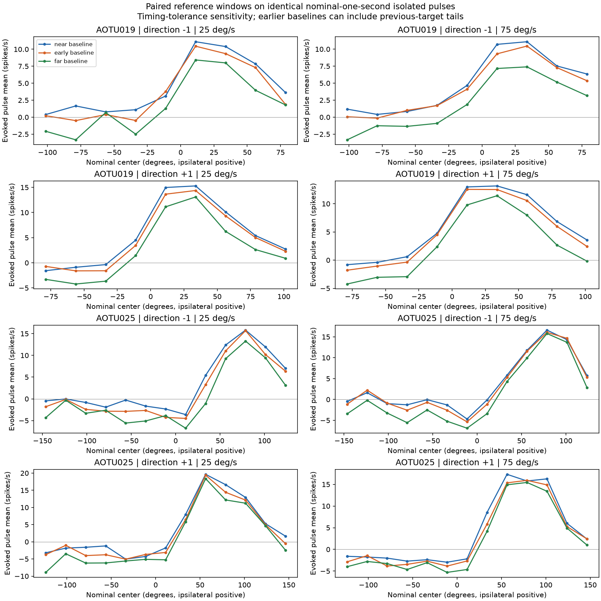
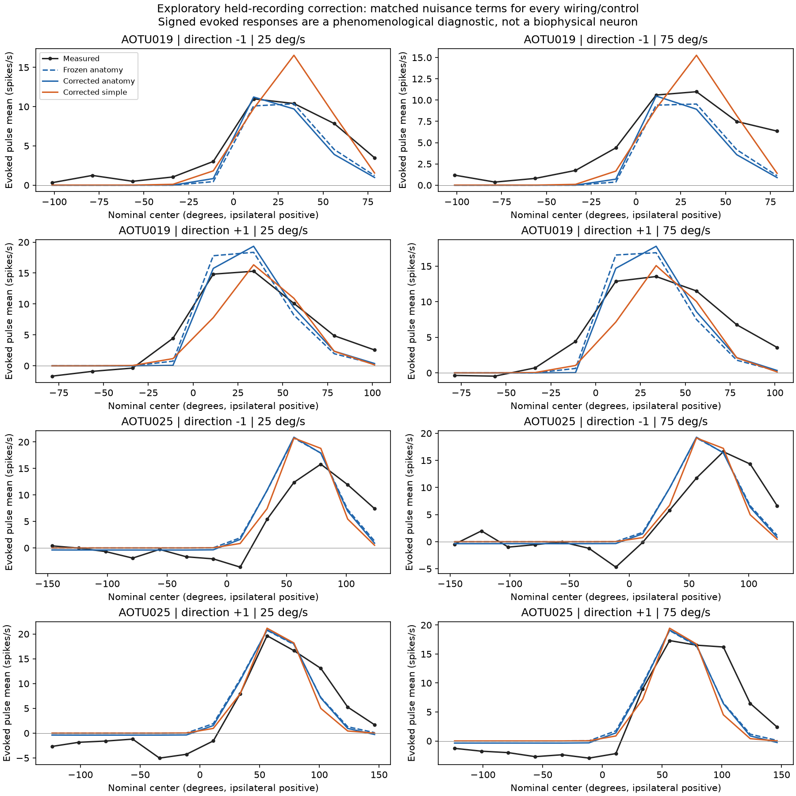

# Pursuit improvement cycle: correction rejected

## Decision

The goal cycle is complete: audit the reference/history ambiguity, freeze and
implement one justified correction, check it against matched controls, and
make an adopt/revise/reject decision. **Reject the correction.** The measured
response mismatch is not solved. Production and previous evidence are unchanged.
The [replacement plan](pursuit_replacement_plan.md) defines the next bounded task.

Protocols: [initial goal/history](pursuit_goal_protocol.md),
[posthoc timing sensitivity](pursuit_history_sensitivity.md), and
[candidate correction](pursuit_revision_protocol.md). The candidate was designed
after seeing these recordings; recording-held-out fits are exploratory evidence,
not independent confirmation of a newly discovered mechanism.

## What the history audit establishes

All 35,484 quiet pulses were retained for the audit, from 69 recordings in four
type/condition groups. The original extraction accounts for 65,416 accepted
intervals and 158 rejected intervals across all movement states. The known
duplicate recording remains excluded. The native near-reference response
exactly reproduces the earlier repeatability data.

The literal one-second hidden-gap cutoff selects timestamp quantization around
a nominal one-second gap. Its frozen results are preserved. A separately labeled
posthoc sensitivity uses >=0.995 seconds; it does not replace the original cutoff.
All three reference windows must be valid and hidden in either paired analysis.

For P1 AOTU025, nonpreferred positions (center <=0 degrees) remain below their
reference across all three paired baseline choices. Values below average equally
within trials/recordings and then across eligible stimulus cells; they are not
all-pulse pooled averages.

| Paired subset | Near reference | Early reference | Far reference |
| --- | ---: | ---: | ---: |
| Literal >=1 s gap | -1.666 | -3.165 | -4.391 |
| Nominal >=0.995 s gap | -2.006 | -3.074 | -5.254 |

Units are spikes/s relative to the chosen reference. Near is [-250,-100] ms,
early [-550,-400] ms, far [-950,-800] ms before onset. Nominal paired AOTU025
coverage is 12,535 pulses in 22 recordings; near is negative in 18/22 recording
means. Its negative response therefore does not disappear with an alternative
reference, but **this does not establish biological inhibition**. In a one-second
gap the far window starts about 50 ms after the preceding target disappears and
may contain its response tail. There are no eligible AOTU025 two-second-gap
records, and no first-pulse cohort with all three valid windows and a one-second
gap. Independence from preceding targets cannot be established here.

Direction -1 AOTU025 coarse peaks remain at 78.75 degrees, while direction +1
fast peaks change between 56.25 and 78.75 with reference choice. These coarse
pulse means do not justify shifting the whole eye map. AOTU019 also changes
with baseline; neither type warrants a global offset correction on this evidence.



## The implemented correction and its test

Frozen anatomical response f(theta,d) was augmented with two direction-sensitive
derivative features f +/- 22.5*d*df/dtheta and a negative target-visible feature.
Three nonnegative coefficients were fitted on training recordings, imposing an
equivalent derivative skew within +/-22.5 degrees and a nonpositive visible
offset. This is an engineered signed evoked-response correction, not a new
biophysical neuron or literal shifted receptive field.

The same three-feature budget was applied to anatomy, 32 fixed wiring shuffles,
simple spatial predictions, and a flat visibility control. Native complete
trials, the existing 50 ms observation filter, original near reference, and
exact earlier recording exclusions/calibration coverage were preserved.

| P1 type | Static RMSE | Corrected RMSE | Error reduction | Recording wins |
| --- | ---: | ---: | ---: | ---: |
| AOTU019 | 11.02839 | 11.02203 | 0.058% | 11/24 |
| AOTU025 | 14.51848 | 14.54232 | -0.164% | 4/22 |

RMSE is the average of recording-level, trial-balanced errors, in spikes/s.
The frozen predictive gate required >=5% improvement and >=60% recording wins
for both P1 types. Neither passes. Corrected anatomy beats equally corrected
simple spatial predictions by only 0.374%/0.483%, below the 1% wiring criterion.
It beats 0/32 shuffles for AOTU019 and 32/32 for AOTU025, failing the requirement
that both types beat at least 30. NoP1 improvements are also negligible or
negative. AOTU025's shuffle ordering alone does not establish useful fly-specific
prediction when its intact correction worsens error and the simple control is
almost as good. Flat-control floating-point ties are not improvements.



## Checks and saved evidence

Two full native replays reproduce every original result artifact and both figures
byte-for-byte. Independent saved-data checks reconstruct eligible trials,
recording/population means, all 2,415 fits, static calibrations, errors, summary
rankings and acceptance gates. SciPy NNLS independently confirms constrained
fit optimality; maximum loss reconstruction discrepancy is 7.11e-15, and maximum
independent training-objective discrepancy is 1.14e-13. Native convolution parity
is <=2.23e-15; old static-feature parity is <=4.45e-16. Protected implementation
and circuit JSON hashes remain unchanged. No unit-test or gameplay suite ran;
these checks concern the offline experiment, not player experience.

Compact evidence is in `docs/evidence/pursuit_history_*v2*` and
`docs/evidence/pursuit_revision_*v1*`: provenance reports, population cells,
summary/rank tables, intact recording fits, independent checks and figures.
Full observations, features and all control folds remain in ignored outputs.
No raw connectome or recording archive is committed.

## Reproduce

From the workspace root with the existing physiology-research dependencies and
four checksum-verified recording archives in the default ignored data directory:

```powershell
$env:PYTHONPATH = 'fly-creature/src'
.\.venv\Scripts\python.exe -m fly_creature.pursuit_history --output-dir fly-creature/outputs/research/aotu-history-v2
.\.venv\Scripts\python.exe -m fly_creature.pursuit_history --output-dir fly-creature/outputs/research/aotu-history-repeat
.\.venv\Scripts\python.exe -m fly_creature.pursuit_revision --output-dir fly-creature/outputs/research/aotu-revision-v1
.\.venv\Scripts\python.exe -m fly_creature.pursuit_revision --output-dir fly-creature/outputs/research/aotu-revision-repeat
.\.venv\Scripts\python.exe fly-creature/tools/plot_pursuit_cycle.py --history fly-creature/outputs/research/aotu-history-v2 --revision fly-creature/outputs/research/aotu-revision-v1
.\.venv\Scripts\python.exe fly-creature/tools/plot_pursuit_cycle.py --history fly-creature/outputs/research/aotu-history-repeat --revision fly-creature/outputs/research/aotu-revision-repeat
.\.venv\Scripts\python.exe fly-creature/tools/check_pursuit_cycle.py --history fly-creature/outputs/research/aotu-history-v2 fly-creature/outputs/research/aotu-history-repeat --revision fly-creature/outputs/research/aotu-revision-v1 fly-creature/outputs/research/aotu-revision-repeat
```

The checker also requires preserved initial history-v1, population-v1 and
repeatability artifacts; this is a chained offline experiment, not a standalone
download. See the earlier population result for their reproduction and provenance.
