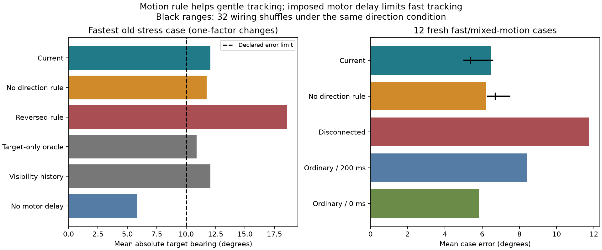

# Motion diagnosis: delay limit and direction-rule tradeoff

2026-10-02. [Protocol](pursuit_motion_protocol.md),
[JSON](evidence/pursuit_motion_v1.json), [CSV](evidence/pursuit_motion_v1.csv).
All 48 frozen stress cases reproduce exactly. No tested input change qualifies
for promotion. Production Python, Godot, circuit, map and gain are unchanged.

## Research and geometry

[Collie et al.](https://pmc.ncbi.nlm.nih.gov/articles/PMC12212441/) reports
AOTU019 preference for ipsiversive motion and describes direction sensitivity
as dependence on the sign of retinal error change, not world-frame target
speed. The [authors' code](https://github.com/wilson-lab/CollieWilson/blob/65d72773121ffe148b56b8ba4f594a7a51c51789/Modeling_Code/aotu_steering_model.m)
uses visual-position history after steering feedback. The local pinned
checkout remains `65d72773121ffe148b56b8ba4f594a7a51c51789`; its suppression
signs match ours. Our 0.66 penalty is imposed by the model, not inferred from
the connections. Normalization and receptive fields remain hypotheses.

A stationary target with a body turn of 0.01 radians changes retinal bearing
by -0.572958 degrees while target-only motion is zero. A moving target with
fixed body gives matching retinal and target-only changes. Including self-motion
is expected geometry, not a sign bug. Reversing the direction rule worsens
tracking. A target-only oracle needs information unavailable to our retinal
sensor and is not presumed biologically better.

## Controlled old-case interventions

| Intervention | 36 supported-case mean | Six fast/reversing-case mean | Fastest unmirrored case |
| --- | ---: | ---: | ---: |
| Current model | 4.352 | 8.217 | 12.050 |
| Remove direction rule | 5.122 | 7.317 | 11.736 |
| Reverse direction rule | 6.826 | 12.356 | 18.573 |
| Target-only motion oracle | 4.035 | 6.781 | 10.873 |
| Continuous visibility history | 4.352 | 8.217 | 12.050 |
| Remove motor queue | 3.090 | 4.392 | 5.851 |

All errors are degrees with the original body/scoring. The hard subset contains
frequency 1.7/3 rad/s and reversal period 2 s, each mirrored. Frequency denotes
the lateral sinusoid's angular frequency, not retinal target speed. The 1.7
case passes the error envelope but loses to median shuffles; only the fastest
speed cases fail the error gate.

Removing direction sensitivity improves the hard subset by 11.0%, but worsens
supported aggregate error by 17.7%. Twenty-six supported cases worsen by more
than 10%, including slow motion and reappearance. It fails the registered
selection criteria. Continuous-visible history does not improve the hard
subset; none of its old-case changes affects reported error. Target-only motion
does not fix the fastest case and was never a promotion candidate.

Removing only the 200 ms queue cuts the fastest error by 51.4%. Delivered
nonzero commands opposing current visible error (outside a one-degree band)
fall from 16.6% to 1.7%. These commands are delivered after the queue to be
applied on the next body tick; this is not a count of actual body rotations.
Stale feedback is the strongest tested cause. This does not justify zero
biological latency or establish the correct distribution of visual/motor
delays. Other delay values and combinations were deliberately not searched.

## Fresh cases and wiring controls

After old-case selection rejected both candidates, 12 previously unused
mirrored chirp, asymmetric and amplitude-modulated paths ran at depths 5/7 m.
No fresh result selected or retuned a parameter. Position-only remained an
explanatory comparison. Each neural condition has a 200 ms queue.

| Controller | Fresh mean error | Envelope cases | Beats shuffled aggregates |
| --- | ---: | ---: | ---: |
| Current intact | 6.459 | 12/12 | 1/32 |
| Intact without direction rule | 6.218 | 12/12 | 32/32 |
| Disconnected | 11.739 | 4/12 | Not tested |
| Ordinary proportional, 200 ms | 8.414 | 10/12 | Not applicable |
| Same ordinary rule, no delay | 5.825 | 12/12 | Not applicable |

The current model's anatomical advantage **does not generalize** to this
fast/mixed-motion set. It beats disconnection and matched-delay proportional
steering, but 31/32 shuffles do better in aggregate. Without direction
sensitivity, intact again beats every matched shuffle, yet fresh error improves
only 3.7% and gentle-case regressions remain. Neither input change qualifies.
The prior stress result remains correct for its paths; it is not a universal
guarantee. Shuffle ranks describe fixed model controls, not biological samples.



## Validation and continuation

Two complete runs produce byte-identical JSON. An independent checker
recomputes 24 fresh CSV traces, all 48 baseline metrics, hashes, aggregates,
envelope counts and shuffle ranks. Four new tests check tick-for-tick parity
with actual runtime, geometry, visibility history and fresh-path reflection.
All 32 creature and 69 lab tests pass; original/working data verification
passes. No application or dependency was added.

From the workspace root:

```powershell
.\.venv\Scripts\python.exe -m fly_creature.pursuit_motion_diagnostic
.\.venv\Scripts\python.exe fly-creature/tools/check_pursuit_motion.py
.\.venv\Scripts\python.exe fly-creature/tools/plot_pursuit_motion.py
```

This is a completed diagnosis, not a fixed controller. Next design question:
how should published visual-response and end-to-end steering timing constrain
the activity model, rather than placing all 200 ms in a command FIFO?
Audit the timing contract before changing it. Measured response latency,
fitted feedback delay and body execution delay are not interchangeable.
Sol medium is recommended for that research/design. Adding neurons or tuning
gain would not answer the diagnosed question.
