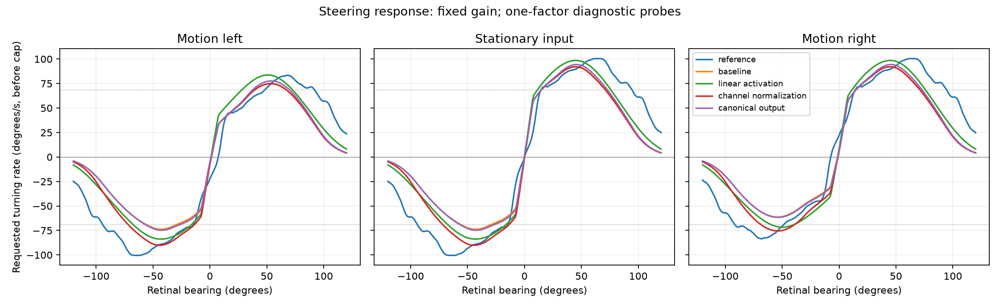

# Response diagnosis: input shape dominates the wide-angle gap

2026-10-02. [Protocol](pursuit_response_protocol.md),
[evidence](evidence/pursuit_response_v1.json),
[replays](evidence/pursuit_response_v1.csv).
The production controller, timing, gain, circuit and map remain unchanged.



## Plain-language result

Our fly gets a much weaker modeled visual signal when a target is far to its
side. The output connections are mostly passing along that already-weak signal.
The nonlinear transformation weakens it further. This explains a specific
wide-angle acquisition deficit; it does not explain every fast-motion problem.

At stationary right 105 degrees, requested turning is **14.36 degrees/s** in
our adaptation versus **56.53 degrees/s** in the reference, before the identical
turn cap. The unmirrored step reproduces 14.701 versus 8.993 degrees mean error.
No queue, gain or cap changes are needed to reproduce this difference.

## Where the difference enters

At the same angle, our right AOTU025 input is 34.35% of its type peak, versus
77.24% in the reference's normalized field. The common nonlinear lookup converts
these to 0.2225 versus 0.7216 activity. AOTU019 adds 0.0083 versus 0.1494.
These are model activity units, not firing rates. The profile difference is
already present before the nonlinear stage and output decoding.

| One changed factor | Stationary signal at right 105 degrees |
| --- | ---: |
| Baseline adaptation | 0.2210 |
| Unit output magnitudes, same signs/topology | 0.2308 |
| Linear activation, same normalized input/edges | 0.3467 |
| Per-channel rather than shared-type normalization | 0.2210 |
| Quantized DN readout as in source | 0.2252 |
| Source-inspired reference | 0.8696 |

Unit output magnitudes recover only 0.0098 of the 0.6486 signal gap at this
point. Removing the nonlinear stage helps, but leaves a large deficit.
Per-channel normalization cannot change this right-side point: the right
channels already define their type maxima. These counterfactuals locate a
major gap in the input profile; they do not prove the reference profile is
biologically correct or that a wider Gaussian is the right fix.

## Asymmetry and normalization

Across visible bearings and all three motion signs, maximum mirrored signal
mismatch is 0.2881. Symmetrizing only the raw input curves lowers it to 0.0363;
symmetrizing only output weights gives 0.3134. Per-channel normalization lowers
it to 0.0831. Input differences dominate this modeled asymmetry. Unequal output
weights are not its primary cause. Exact symmetry is not a biological requirement.

Original left input peaks are 89.13% (AOTU019) and 84.02% (AOTU025) of the shared
type peaks. Normalizing each channel independently removes that amplitude
difference, but also removes real anatomical count differences. It is a
diagnostic, not automatically a sound replacement. Left fields rely much more
on skeleton fallback than right fields, as the prior registered-map audit shows.

The direction penalty is applied before ELU. At right 20 degrees, multiplying
AOTU019 input by 0.66 reduces activated output from 0.9988 to 0.5829, about
0.584 of the stationary value. The imposed penalty is not a simple 34% reduction
of final activity. At zero bearing, changing motion sign switches the adaptation's
requested rate by 11.96 degrees/s; the reference switches by 43.92 degrees/s.
Direction-switch discontinuity is present in both models and is not itself an
implementation error. Neither clipping nor DN quantization explains the broad
profile gap: no DN clipping occurs in the decomposed visible baseline samples.

## One-factor replays

Mean absolute retinal error in degrees on the already-consumed 22 cases:

| Family | Baseline | Per-channel normalization | Linear activation | Canonical output |
| --- | ---: | ---: | ---: | ---: |
| Steps | 6.310 | 5.978 | 5.584 | 6.224 |
| Slow sweeps | 6.267 | 5.807 | 5.541 | 6.214 |
| Fast sweeps | 25.241 | 25.291 | 26.224 | 25.178 |
| Smooth paths | 7.875 | 7.370 | 7.199 | 7.753 |
| Older motion paths | 7.180 | 6.707 | 6.229 | 7.088 |

Linear activation helps four families and worsens fast sweeps. Channel
normalization has a similar, smaller tradeoff. Output symmetrization and
quantization have small effects. No probe is promoted. These replays diagnose
existing evidence; they are not fresh validation, do not test all translating
world regressions, and contain no new wiring-shuffle evaluation of the probes.

## The reference is also an anatomical approximation

The pinned [heatmap analysis](https://github.com/wilson-lab/CollieWilson/blob/65d72773121ffe148b56b8ba4f594a7a51c51789/Connectomics_Code/heatmap_analysis.m)
uses rendered LC10a mesh images, a Gaussian smoothing window of 30 image
samples, then linearly assigns the detected LC10a image extent to -15 through
165 degrees (`rPos = linspace(...)`). The
[rendering code](https://github.com/wilson-lab/CollieWilson/blob/65d72773121ffe148b56b8ba4f594a7a51c51789/Connectomics_Code/AOTU_MaleCNS/lc10_heatmap_male.R)
uses an anatomical view and contact-weight coloring. This differs from our
eye-vector registration, cell-center averaging and fixed 18-degree Gaussian.
Agreement with that image-derived reference is useful model comparison,
not evidence that its broad tail is measured LC10a visual physiology.
The missing final CSV-construction step remains a provenance limit.

Our saved map already contains upstream angular spread for 164 directly
mapped cells, but the current projection ignores it. Contact-weighted mean
spreads within the direct subset are about 3.3–5.5 degrees across branches,
with some right-side cells reaching 34.2 degrees. These are spreads of
anatomical input-column angles, not measured receptive-field widths. Simply
substituting these numbers for 18 degrees could narrow most fields and make
the wide-angle problem worse. The map also has 111 fallback cells.

## Verification and next step

All 22 baseline and reference replays exactly reproduce the previous benchmark.
Input hashes agree. Contribution sums reconstruct actual output to 1.11e-16.
Four new tests check stage isolation, immutability, signs, reconstruction and
mirror identities. All 108 lab/creature tests pass; JSON, CSV and PNG repeat
byte-identically; all 40 aggregates are independently checked. The 17 pinned
source hashes and original/working release verification pass.

Run from the workspace root (existing `research-plots` dependency is needed):

```powershell
.\.venv\Scripts\python.exe -m fly_creature.pursuit_response_diagnostic fly-creature/outputs/research/CollieWilson/Modeling_Code/Pursuit_RFs.csv
```

Next build an **offline column-footprint input candidate**: retain each directly
mapped cell's upstream angle distribution instead of collapsing it to one
center, reuse the 18-degree kernel at column level as a new declared assumption, and
separate directly mapped evidence from fallback uncertainty. Start with fixed-fly
curves and normalization checks before behavioral validation. Do not widen fields
until they match the author curve, or silently remove the nonlinear response.
Sol medium fits the input-contract design and its anatomical uncertainty.

This proposed candidate is now [implemented and evaluated](pursuit_footprint_result.md).
It preserves spatial distributions but does not improve tracking; production
remains unchanged. That result narrows the center-collapse hypothesis.
