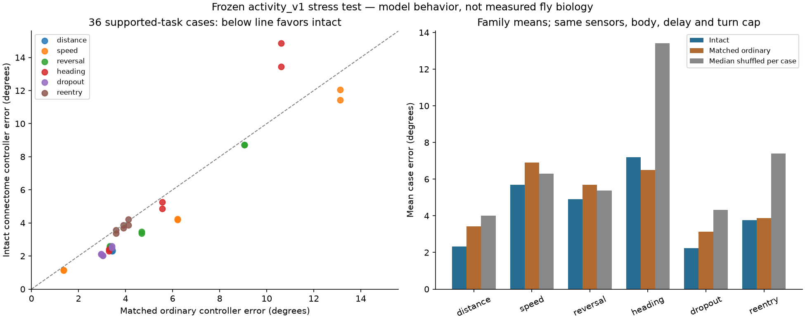

# Pursuit stress test: useful steering, bounded operating range

2026-10-02. [Frozen protocol](pursuit_stress_protocol.md),
[compact JSON](evidence/pursuit_stress_v1.json),
[per-case CSV](evidence/pursuit_stress_v1.csv),
[chart](evidence/pursuit_stress_v1.png).

The working controller was unchanged. Protocol and runner were committed as
`53d28d9` before evaluation, on `experiment/pursuit-stress-envelope`.
The production runtime and Godot remain those in `1d27daa`. Input hashes are
recorded in the evidence. These new cases are now evaluated, not future
held-out validation material.

## What happened

Across 36 supported-task cases, intact wiring met the declared tracking
envelope in 32. It beat all 32 shuffled circuits on aggregate error and the
median shuffle on 30/36 individual cases. This supports a repeatable role for
the particular recorded LC10a outgoing bundles under this model and input
map. It does not validate the map or dynamics as measured fly biology.

| Controller | Mean case error | Cases within envelope |
| --- | ---: | ---: |
| Intact activity controller, 200 ms delay | 4.352 degrees | 32/36 |
| Disconnected | 22.509 degrees | 12/36 |
| Ordinary proportional controller, matched 200 ms delay | 4.918 degrees | 32/36 |
| Same ordinary controller, no delay | 3.645 degrees | 36/36 |

The median aggregate shuffled error was 6.950 degrees (range 4.979–8.894).
Intact beat the matched ordinary controller in 33/36 cases, with about 11.5%
lower aggregate error. That advantage is modest. The immediate ordinary
controller did better overall, so these results do **not** establish that
fly wiring is necessary or superior to ordinary control for this task.

The ordinary gain was selected as 4 rad/s per radian from seven declared
values using only the six older paths, before evaluating the new cases.
Its sensors, body, turn cap and delayed queue match the activity controller.
It remains one proportional controller family, not an exhaustive search for
the best ordinary controller. The immediate version changes only its delay.



## What works and what fails

| Family | Intact mean case error | Within envelope |
| --- | ---: | ---: |
| Following at 3/5/8 m | 2.329 degrees | 6/6 |
| Different lateral speeds | 5.693 degrees | 4/6 |
| Repeated reversals | 4.905 degrees | 6/6 |
| Starting at 25/65/105-degree heading offsets | 7.191 degrees | 4/6 |
| Target disappears while continuing its path | 2.229 degrees | 6/6 |
| Target reappears elsewhere | 3.764 degrees | 6/6 |

The two fastest cases had mean errors of 12.050 and 11.424 degrees. They
remained visible and did not violate the saturation or lookup limits; they
failed the error criterion. Intact was worse than the median shuffle on the
1.7/3 rad/s speed cases and the two-second reversal cases. The wiring benefit
is not uniform across target motion.

The two 105-degree starting offsets had mean errors of 14.857 and 13.455
degrees, but final errors were only 1.612 and 1.593 degrees. The controller
eventually recovered; the full-run mean penalizes its slow initial turn.
Do not describe those cases as permanent inability to face the target.

All disappearance/reappearance cases met the recovery criterion. Recovery
was recorded at completion of 50 consecutive visible, within-10-degree
samples: 0.49–0.74 s after ordinary dropout, 1.12–1.25 s after reappearance
elsewhere. No controller issued a turn while the target was inactive.
The intact run had no lookup clipping in any supported case. The largest
mirror difference was 1.402 degrees on the 105-degree initial heading;
recorded left/right anatomy was not replaced with a symmetric graph.

The disconnected controller passed the coarse envelope on twelve mild
reversal/dropout cases despite never turning. This illustrates why a low
error threshold by itself cannot credit the circuit: some trajectories stay
near the starting heading without any steering at all.

## Challenges outside the current task

Four of six stationary-depth cases passed; both 2.5 m cases failed badly
(about 68-degree mean error, visible about 55% of active time). The body keeps
walking at 0.55 m/s and can pass the nearby target. There is no distance-based
stopping rule or neural forward-speed control. This is a limitation of the
declared whole controller/body contract, not evidence of broken raw data.

None of the six unsupported-input cases passed. Targets behind the body,
farther than 9 m, or initially closer than 0.4 m produced no steering. The
far centered target even has zero bearing error while remaining unseen:
visibility must be checked separately. There is no search or reacquisition
behavior for targets starting outside the sensor field. An ordinary
controller with the same sensor boundary cannot turn toward unseen inputs
either. Challenge aggregate errors are dominated by these designed boundary
conditions and should not be used as a headline performance score.

Most supported targets retreat along the world Z axis at the nominal walk
speed to keep this a pursuit task over ten seconds. Stationary targets are
reported separately. The simulation is an unbounded world, not Godot room
collision physics. Sensory input is geometric bearing, not images; range and
field limits are engineering. The 200 ms delay and 15-degree aperture overlap
remain explicit hypotheses. Error comparisons on 48 deterministic toy cases
are not biological replicates or a demonstration of natural fly behavior.

## Checks and reproduction

Two complete executions produced identical saved JSON reports, including all
case metrics and shuffle outputs. An independent checker recomputed scores,
visibility, saturation, inactive commands and recovery from 96 full traces,
checked frozen hashes and all aggregates. The actual runtime seam reproduced
the known harmonic result (2.349888 degrees versus offline 2.350).
22 creature tests and 69 lab tests pass; raw original/working data verification
passes. Production Python and Godot files have no changes in this experiment.

From the workspace root, with the creature package installed in `.venv`:

```powershell
.\.venv\Scripts\python.exe -m fly_creature.pursuit_stress
.\.venv\Scripts\python.exe fly-creature/tools/check_pursuit_stress.py
$env:MPLCONFIGDIR = "$PWD/fly-creature/outputs/matplotlib"
.\.venv\Scripts\python.exe fly-creature/tools/plot_pursuit_stress.py
```

The plotting script uses the existing optional `research-plots` dependency.
Full traces are ignored under `outputs/research/pursuit_stress/`; compact
evidence and plots are tracked. No new external app or dependency was added.

## Decision and next step

Keep `activity_v1` experimental with its existing settings. Do not retune
gains to erase these failures or claim more neurons would fix them. There is
enough controlled evidence to build a comparison playground: target motion,
intact/disconnected/ordinary modes, visible error and sensor status, and
honest labels for engineered walking versus neural steering. Measure the
bridge cost before altering its logical timing. Recommend Sol medium for
that integration design because interactive transport must preserve the
tested queue and tick contract. Further scientific claims need a new
predeclared question and unseen cases, particularly the motion regimes where
shuffle controls beat intact wiring.
