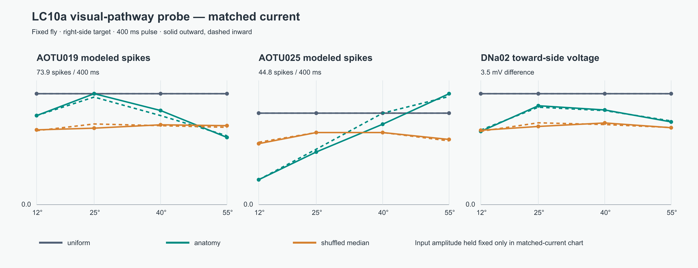

# What the two AOTU branches actually do in our model

This is the promised **fixed-fly circuit probe**. The fly does not move or turn. A scripted target appears 6 m away at 12°, 25°, 40°, or 55° to either side for 400 ms. It stays still or sweeps 10° inward/outward at 25°/s; the two sweeps visit the same positions in reverse order. Each trial starts from a fresh neural state after 100 ms without a target. We record modeled LC10a, AOTU019, AOTU025, and DNa02 activity every 20 ms, then save compact pulse summaries. [Collie et al.](https://pmc.ncbi.nlm.nih.gov/articles/PMC12212441/) used motion pulses and found a more frontal AOTU019 pathway, a more lateral AOTU025 pathway, and a stronger outward-motion preference in frontal AOTU019. Our circuit and input map are different, so these are questions to test, not results to assume.

The [response chart with equal input amplitude](evidence/visual_pathway_probe_v1_matched_current.png) isolates *which cells receive current*: both the old uniform input and the skeleton-derived input deliver the same total current to the stimulated hemisphere at every angle. The [chart with the playable input envelope](evidence/visual_pathway_probe_v1_playable_envelope.png) also includes the existing rule that delivers less current near the center. [Vector SVG](evidence/visual_pathway_probe_v1_matched_current.svg) versions are saved too. The charts show the right hemisphere; both sides are in the [CSV](evidence/visual_pathway_probe_v1.csv) and [compact JSON](evidence/visual_pathway_probe_v1.json). Each chart has modeled AOTU019 spikes, AOTU025 spikes, and the DNa02 voltage difference that would request a turn toward the target. Solid lines are outward motion; dashed lines are inward motion. Orange is the median of 12 within-side LC10a output-bundle wiring shuffles.



## Result at equal total current

For a **stationary right-side** target, the pulse totals were:

| Angle | Input | AOTU019 spikes | AOTU025 spikes | DNa02 toward-side voltage bias |
| --- | --- | ---: | ---: | ---: |
| 12° | Old uniform | 66 | 33 | 3.11 mV |
| 12° | Anatomy hypothesis | 54 | 10 | 2.12 mV |
| 25° | Old uniform | 66 | 33 | 3.11 mV |
| 25° | Anatomy hypothesis | 66 | 21 | 2.82 mV |
| 40° | Old uniform | 66 | 33 | 3.11 mV |
| 40° | Anatomy hypothesis | 59 | 33 | 2.84 mV |
| 55° | Old uniform | 66 | 33 | 3.11 mV |
| 55° | Anatomy hypothesis | 40 | 40 | 2.32 mV |

The uniform input gives each branch essentially the same response at every angle, exactly what its whole-side drive predicts. The anatomical input creates a **coarse positional split**: AOTU025 grows toward the lateral target, while AOTU019 is strongest around the near-to-center 25° sample and weaker laterally. The left side shows the same broad pattern, with different exact counts from its recorded weights. At 25° versus 55°, AOTU019 has 26 fewer modeled spikes on the right and 31 fewer on the left; uniform input changes by zero. At 12° versus 55°, AOTU025 gains 30 spikes on the right and 21 on the left; uniform changes by zero. The median shuffled circuit has little such split. This is a property of the hypothesized per-cell input **aligned with** the selected wiring. Its visual-field orientation was partly inferred from the same output connections, so the shuffled comparison is not independent biological validation.

The anatomical input gives a **smaller DNa02 steering signal than uniform input in all 48 matched and playable probe settings**. This is a concrete reason it could track worse in the moving-fly experiment: the old scheme drives both pathways hard, while the selective scheme redistributes the same current and usually produces less net voltage difference under our fixed decoder. It is not proof that the visual map is wrong; the simulator's current scale and voltage-to-turn gain are also assumptions. No modeled DNa02 cell spiked in these trials.

## Motion result: the missing piece

Static objects drive the circuit strongly. The current input code uses target **position**, with no requirement that it move. Outward and inward sweeps produce some differences because the LIF network sees the same positions in a different order, but there is **no consistent outward preference in AOTU019 across both sides**. For example, at 25° with matched current, right AOTU019 has 66 outward versus 64 inward spikes, while left AOTU019 has 43 outward versus 52 inward. This is unlike the robust ipsiversive direction preference reported experimentally for AOTU019 in [Collie et al.](https://pmc.ncbi.nlm.nih.gov/articles/PMC12212441/). Our assay shows order-dependent simulator dynamics, not evidence that the selected MaleCNS graph has reconstructed biological motion selectivity.

With the actual playable bearing-to-current envelope, targets near 12° get only about 28% of the maximum model input. For a stationary right-side target there, anatomical AOTU019 produced 15 spikes, AOTU025 none, and the DNa02 voltage bias was only 0.53 mV. Equal-amplitude input at that angle produced 54, 10, and 2.12 mV. The low frontal drive is therefore partly our input rule. Changing that rule to increase the pursuit score would be tuning an assumption, not discovering a fly mechanism.

## Decision

Keep the playable scene and its current input unchanged. We now know **what the first per-cell hypothesis adds** (a spatial division of branch responses) and **what it fails to add** (motion preference and stronger or better pursuit output). The next scientific step is to obtain an independently supported per-cell visual-field or motion-input assignment, then repeat this fixed-fly probe before another closed-loop behavior comparison. Do not add neurons, change gain, or declare fly-specific pursuit from these results.

Reproduce the compact outputs from `fly-creature/`:

```powershell
python -m fly_creature.visual_pathway_probe --output docs/evidence/visual_pathway_probe_v1.json --csv docs/evidence/visual_pathway_probe_v1.csv --chart-prefix docs/evidence/visual_pathway_probe_v1
```

That command regenerates the data and canonical SVG charts. The linked PNGs
are rasterized copies for easier viewing; they do not affect the calculations.
